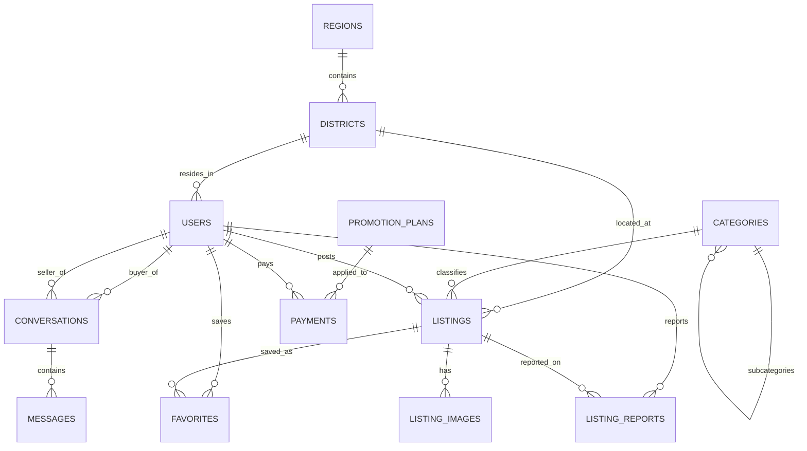

# Universal Hayvonlar Bozori (Pet & Livestock Marketplace) — Ma'lumotlar Bazasi

Ushbu loyiha uy hayvonlari, chorva mollari va parrandalar oldi-sotdisi bilan shug'ullanuvchi platforma (veb-sayt va mobil ilovalar) uchun ishlab chiqilgan to'liq va professional **PostgreSQL** ma'lumotlar bazasi arxitekturasidir.

---

## 📁 Loyiha Tarkibi

* [schema.sql](file:///c:/Users/User/Desktop/n30/database/schema.sql) — Barcha 13 ta asosiy jadval, ENUM turlari, cheklovlar (FK, Unique, Checks), GIN/B-Tree indekslari, `updated_at` va `favorites_count` triggerlari hamda frontend/backend uchun tayyor `v_active_listings` view'si.
* [seed.sql](file:///c:/Users/User/Desktop/n30/database/seed.sql) — O'zbekistonning 14 ta ma'muriy hududi, barcha asosiy tumanlar, hayvonlar ierarxik kategoriyalari, VIP tariflari va realistik test e'lonlari (Chorva, Otlar, Itlar, Mushuklar, Chat xabarlari).
* [docker-compose.yml](file:///c:/Users/User/Desktop/n30/database/docker-compose.yml) — PostgreSQL 16 (healthcheck bilan) va brauzer orqali bazani ko'rish uchun `pgweb` (port: 8080) Web UI konteyneri.
* [.env](file:///c:/Users/User/Desktop/n30/database/.env) va [.env.example](file:///c:/Users/User/Desktop/n30/database/.env.example) — Baza parollari va portlari sozlamalari.
* [sqlite_demo.py](file:///c:/Users/User/Desktop/n30/database/sqlite_demo.py) — Hech narsa o'rnatmasdan turib, standart Python bilan bazani darhol lokal sinab ko'rish skripti.
* [brainstorms/2026-10-22-database-loyihasi.md](file:///c:/Users/User/Desktop/n30/database/brainstorms/2026-10-22-database-loyihasi.md) — Grill-me sessiyasi davomida qabul qilingan barcha qarorlar qaydlari.

---

## 🧩 Jadvallar Tuzilmasi (ERD Arxitekturasi)



### Jadvallar ro'yxati:
1. `regions` — O'zbekistonning 12 ta viloyati, Toshkent shahri va Qoraqalpog'iston Respublikasi (14 ta hudud).
2. `districts` — Viloyat tumanlari va shaharlari (aniq joylashuv bo'yicha tezkor filtratsiya).
3. `users` — Foydalanuvchilar (telefon raqam, ism, rol, avatar, Telegram profil).
4. `otp_codes` — SMS tasdiqlash kodlari va amal qilish muddatlari.
5. `categories` — Daraxtsimon hayvon turlari (Chorva, Uy hayvonlari, Parrandalar va ularning osttoifalari).
6. `listings` — E'lonlar (narx, valyuta, tavsif, zoti, emlanganlik, JSONB dinamik atributlar, VIP status).
7. `listing_images` — E'lon suratlari (bosh rasm bayrog'i, tartib raqami).
8. `favorites` — Xaridorlar tomonidan saqlab qo'yilgan (sevimli) e'lonlar.
9. `conversations` — E'longa bog'langan xaridor va sotuvchi o'rtasidagi chat xonasi.
10. `messages` — Chat xabarlari (matn, rasm, o'qildi statusi).
11. `listing_reports` — Shikoyatlar (firibgarlik, taqiqlangan yovvoyi hayvonlar).
12. `promotion_plans` — VIP / TOP / Shoshilinch e'lon tariflari.
13. `payments` — Click va Payme orqali to'lov tranzaksiyalari.

---

## 🚀 Ishga Tushirish

### 1-Usul: Python orqali lokal sinov (Hech narsa o'rnatish shart emas)
```bash
python sqlite_demo.py
```
Bu buyruq `marketplace_demo.db` faylini yaratadi, test ma'lumotlarini yuklaydi va 3 xil asosiy so'rov (VIP lenta, viloyat bo'yicha filtr, chat tarixi) natijalarini ko'rsatadi.

### 2-Usul: Docker Compose orqali (PostgreSQL 16)
Docker o'rnatilgan tizimda loyiha papkasida:
```bash
docker compose up -d
```
* **PostgreSQL manzili:** `localhost:5432`
* **Web UI (Brauzer orqali boshqarish):** `http://localhost:8080` (pgweb ochiladi)

---

## ⚡ FastAPI Backend Server (REST API)

Loyiha uchun to'liq ishlovchi **FastAPI** backend serveri yaratildi.

### Serverni ishga tushirish:
```bash
python backend/run.py
```
yoki Windows'da [start_api.bat](file:///c:/Users/User/Desktop/n30/database/start_api.bat) faylini ikki marta bosing.

* **Admin Boshqaruv Paneli:** `http://127.0.0.1:8000/admin` (Statistika, VIP qilish, bloklash, shikoyatlar nazorati)
* **API Asosiy sahifa:** `http://127.0.0.1:8000`
* **Interaktiv Swagger Hujjatlari:** `http://127.0.0.1:8000/docs` (brauzer orqali har bir endpointni test qilish mumkin)

### Mavjud API Endpointlar:
* `GET /api/locations/regions` — O'zbekistonning 14 ta viloyati
* `GET /api/locations/districts?region_id=...` — Viloyat tumanlari
* `GET /api/categories` — Kategoriyalar va ost-kategoriyalar daraxti
* `POST /api/auth/send-otp` — SMS tasdiqlash kodini yuborish (test kodi: `7777`)
* `POST /api/auth/verify-otp` — Kodni tasdiqlab tizimga kirish / ro'yxatdan o'tish
* `GET /api/listings` — E'lonlar lentasi (qidiruv, kategoriya, viloyat, narx va VIP filtrlari bilan)
* `GET /api/listings/{id}` — E'lon detallari va rasmlari (ko'rishlar sonini avtomat oshiradi)
* `POST /api/listings` — Yangi e'lon joylash
* `POST /api/listings/{id}/favorite` — E'lonni sevimlilarga qo'shish / o'chirish
* `GET /api/chat/conversations` — Foydalanuvchining chat suhbatlari
* `GET /api/chat/conversations/{id}/messages` — Chatdagi xabarlar tarixi
* `POST /api/chat/messages` — Yangi xabar yuborish

### Avtomatik sinov:
```bash
python backend/test_api.py
```
